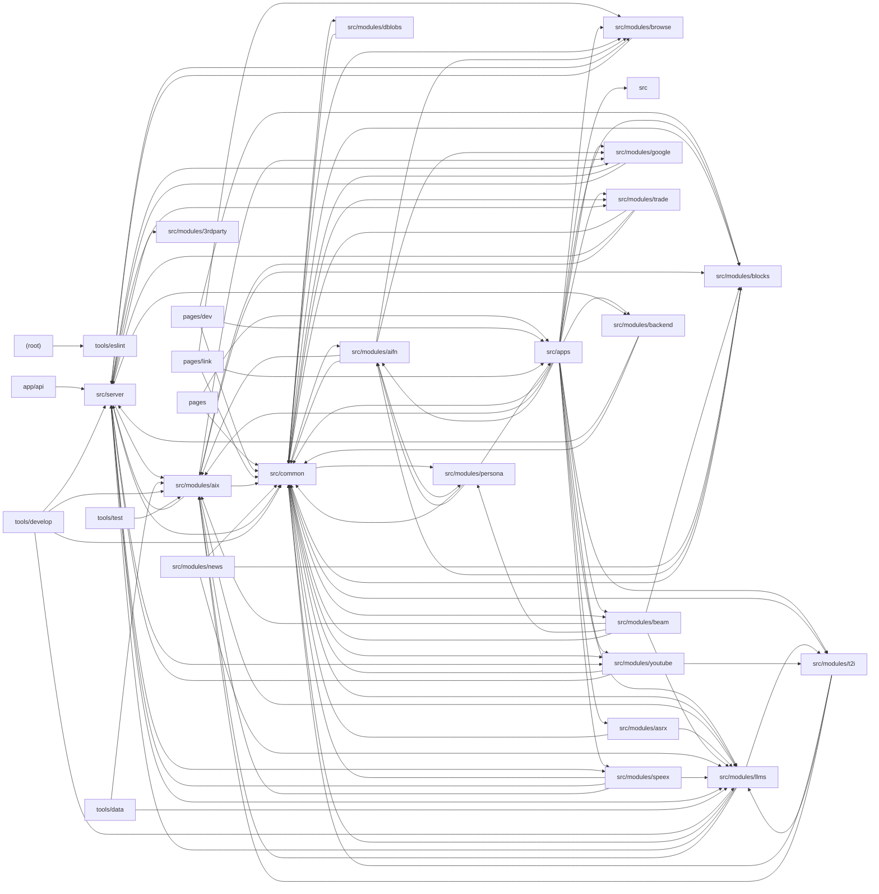

# Architecture

Big-AGI is a Next.js (Pages Router for UI, App Router for tRPC API routes) TypeScript application for multi-model AI chat, Beam multi-model comparison/fusion, voice calls, text-to-image, personas, and developer LLM tooling. The UI layer (pages → src/apps) composes feature sub-applications wrapped in the shared 'Optima' per-page layout and draws on a large shared layer (src/common) of Zustand stores (chats, LLMs, UI, attachment drafts), hooks, UI primitives, token estimators, and utilities. Feature modules under src/modules provide the AI execution core (aix: unified client/server request adapters, streaming parsers, particle reassembly across Anthropic, Bedrock, Gemini, OpenAI/OpenRouter, xAI, Ollama), LLM vendor catalogs and setup (llms), AI utility functions (aifn), Beam, content block rendering (blocks), TTS (speex), ASR (asrx), T2I (t2i), browsing, Google search/grounding, dblobs persistence, trade/export, news, and personas prompt mixing. The server layer (src/server) hosts env validation (vendored t3-env), tRPC initialization/routers split into Edge and Node (cloud) runtimes, Prisma, PostHog, and retry/fetch helpers. Supporting tooling includes custom ESLint rules, model registry sync CLIs, protocol labs, and zero-dependency browser diagnostic pages under public/dev.

## Modules

| module | summary | AI |
| --- | --- | --- |
| `.claude/scripts` | CLI script parsing the Ollama library HTML catalog into pipe-delimited model metadata. | — |
| `(root)` | Next.js, Webpack, TypeScript and flat ESLint configuration including tiktoken WASM and server-module client mocks. | — |
| `app/api` | App Router route handlers exposing tRPC endpoints on Node.js (cloud) and Edge runtimes. | — |
| `pages` | Pages Router app shell (_app/_document) and Optima-wrapped routes for chat, draw, call, personas, diff, tokens, news, workspace. | — |
| `pages/dev` | Developer debug and LLM capability inspection pages. | — |
| `pages/link` | Entry points for OpenRouter OAuth callback, shared chat links, and Web Share Target. | — |
| `public` | Static assets including the session-moved notice page. | — |
| `public/dev` | Zero-dependency browser diagnostic tools for storage, logs, boot checks, and repair. | [AI] |
| `public/vendor` | Vendored minified SheetJS build exposing the global XLSX object. | — |
| `public/workers` | Pre-compiled PDF.js web worker for off-thread PDF processing. | — |
| `src` | System purpose/persona definitions with prompt templates, examples, and voice IDs. | [AI] |
| `src/apps` | Feature sub-applications: chat (composer, messages, panes, editors), Beam harness, call, draw, diff, personas, settings, news, tokens, link-chat, LLM capabilities. | [AI] |
| `src/common` | Shared infrastructure: Zustand stores (chats, LLMs, UI, folders), attachment drafts, Optima layout, UI primitives, token estimators, logging, providers, and utilities. | [AI] |
| `src/modules/3rdparty` | Vendored t3-env implementation for Standard-Schema-based environment validation. | — |
| `src/modules/aifn` | AI utility functions: auto-title, follow-ups, code/diagram fixup, flattening, image captioning, imagine prompts, ReAct agent, LLM chains. | [AI] |
| `src/modules/aix` | Unified AI execution layer: client request building/reassembly/debugger plus server dispatch adapters, parsers, demuxers, retries across all vendors. | [AI] |
| `src/modules/asrx` | Speech recognition engines and batch transcription across Deepgram, Gemini, and OpenAI. | [AI] |
| `src/modules/backend` | tRPC router exposing backend capabilities and OpenRouter key exchange, with client capability store. | — |
| `src/modules/beam` | Beam multi-model scatter (rays) and gather (fusions) orchestration, stores, and views. | [AI] |
| `src/modules/blocks` | Rendering of markdown, code (Prism, Chart.js, Mermaid, PlantUML, SVG, HTML iframes), images, and diffs with AI fixups. | [AI] |
| `src/modules/browse` | Puppeteer-based web page fetching and HTML-to-markdown conversion via tRPC. | — |
| `src/modules/dblobs` | Dexie/IndexedDB persistence for image and audio blob assets with live query hooks and GC. | [AI] |
| `src/modules/google` | Google Custom Search integration and Vertex AI grounding link resolution. | — |
| `src/modules/llms` | LLM vendor registry, service setup UIs, model options modals, server access configs, per-vendor model catalogs, and list-models dispatch. | [AI] |
| `src/modules/news` | In-app news, changelog, and docs reader fetched from the big-agi.com API. | [AI] |
| `src/modules/persona` | Prompt Mixer (pmix) variable registry and template substitution for system prompts. | [AI] |
| `src/modules/speex` | Text-to-speech engines and streaming synthesis across ElevenLabs, Gemini, Inworld, LocalAI, OpenAI, and WebSpeech. | [AI] |
| `src/modules/t2i` | Text-to-image engine lifecycle and generation via OpenAI/Azure/LocalAI, Gemini, and OpenRouter. | [AI] |
| `src/modules/trade` | Conversation import/export, Flash backup/restore, shared chat links, and Claude Code transcript export. | [AI] |
| `src/modules/youtube` | Server-side YouTube transcript fetching with client hook and URL input component. | — |
| `src/server` | Server infrastructure: env validation, tRPC init and Edge/Cloud routers, Prisma, PostHog, fetch/retry helpers. | [AI] |
| `tools/data` | CLI syncing LLM vendor model listings into a local SQLite registry. | [AI] |
| `tools/develop` | Developer harnesses and generators: AIX protocol lab, vendor API probes, Claude Code transcript analysis, sprite/defs generators, SWC minify checks. | [AI] |
| `tools/eslint` | Custom ESLint plugins guarding memo props, outcome type casts, SWC miscompiles, and computed sx values. | — |
| `tools/test` | Scale test for the OpenAI sandbox container keep-alive companion against a mock API. | [AI] |

## Module dependencies

_`[AI]` marks modules with AI/LLM touchpoints (prompt files, model API calls, agent logic)._
