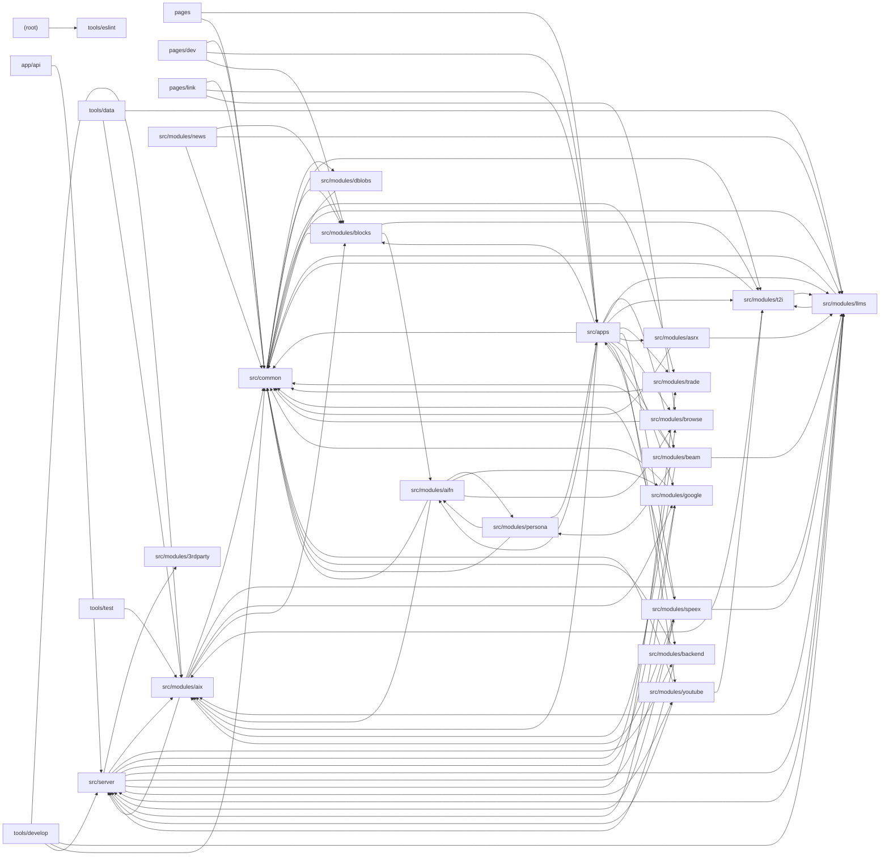

# Architecture

Big-AGI is a Next.js (Pages router + App router API routes) multi-model AI chat workspace. The browser runs the full product UI under `src/apps` (Chat, Beam, Call, Draw, Personas, Diff, Tokens, LinkChat, settings) on top of a large shared layer in `src/common` (Optima layout, Zustand stores for chats/LLMs/UI, attachment drafts, token counting, logging, providers, utilities). AI execution flows through the AIX subsystem (`src/modules/aix`): the client builds unified chat-generate requests and reassembles streamed particles, while the server side adapts requests to vendor wire formats (Anthropic, Bedrock, Gemini, OpenAI-compatible, xAI, Ollama), parses vendor streams, and handles retries/continuations. tRPC routers (`src/server`) are mounted on Edge (`app/api/edge`) and Node (`app/api/cloud`) runtimes via `app/api`. Satellite modules provide vendor/model catalogs and setup UI (`src/modules/llms`), utility AI functions (`aifn`), persona prompt mixing (`persona`), TTS (`speex`), ASR (`asrx`), text-to-image (`t2i`), web browsing, Google search/Vertex link resolution, YouTube transcripts, IndexedDB blob storage (`dblobs`), import/export (`trade`), news, and rich block rendering (`blocks`). Static diagnostics live in `public/dev`, and `tools/*` hold ESLint rules, registry sync, protocol labs and minifier checks for developers.

## Modules

| module | summary | AI |
| --- | --- | --- |
| `.claude/scripts` | Node CLI script that parses Ollama library HTML into pipe-delimited chat model records. | — |
| `(root)` | Next.js build/webpack config, ESLint flat config with custom rules, and ambient TS declarations. | — |
| `app/api` | App-router route handlers mounting tRPC on Node (/api/cloud) and Edge (/api/edge) runtimes. | — |
| `pages` | Pages-router entry points, _app/_document setup, and per-app routes wrapped in the Optima layout. | — |
| `pages/dev` | Developer debug and LLM-capabilities diagnostic pages. | — |
| `pages/link` | OpenRouter OAuth callback, shared chat link viewer, and Web Share Target routes. | — |
| `public` | Static assets and the session-moved fallback HTML page. | — |
| `public/dev` | Zero-dependency static Inspect tools (doctor, heal, logs, storage) for troubleshooting boot and storage. | [AI] |
| `public/vendor` | Vendored SheetJS mini build for client-side spreadsheet parsing. | — |
| `public/workers` | PDF.js web worker bundle for background PDF processing. | — |
| `src` | SystemPurposes persona presets with system prompt templates and metadata. | [AI] |
| `src/apps` | End-user applications: Chat (composer, messages, panes, editors), Beam, Call, Draw, Personas, Diff, Tokens, LinkChat, Settings, News. | [AI] |
| `src/common` | Shared layout engine, Zustand stores (chats, LLMs, UI, metrics), attachment drafts, tokens, logging, providers, components and utilities. | [AI] |
| `src/modules/3rdparty` | Inlined t3-env style environment variable validation library. | — |
| `src/modules/aifn` | Utility AI functions: auto-title, follow-ups, code fixup, diagrams, flatten, captioning, imagine prompts, ReAct agent, LLM chains. | [AI] |
| `src/modules/aix` | Unified AI exchange layer: client request building/particle reassembly, server vendor adapters, stream parsers, retries and debugging. | [AI] |
| `src/modules/asrx` | Speech-to-text engines (Deepgram, Gemini, OpenAI) with client-side batch transcription and engine store. | [AI] |
| `src/modules/backend` | Backend capability flags via tRPC, OpenRouter key exchange, and frontend capabilities store. | — |
| `src/modules/beam` | Multi-model Scatter/Gather (rays and fusions) workflow, stores and UI. | [AI] |
| `src/modules/blocks` | Message content rendering: markdown, code highlighting, Chart.js/Mermaid/PlantUML/SVG/HTML previews, diffs, images, LiveFile patching. | [AI] |
| `src/modules/browse` | Remote Puppeteer web page fetching and HTML-to-Markdown conversion for AI consumption. | — |
| `src/modules/dblobs` | Dexie/IndexedDB storage, hooks, thumbnails and GC for binary assets. | [AI] |
| `src/modules/google` | Google Custom Search integration and Vertex AI grounding link resolution. | — |
| `src/modules/llms` | Vendor registry, model catalogs/definitions, access/signing, list-models routers, and model configuration UI for 30+ providers. | [AI] |
| `src/modules/news` | Remote news/changelog feed, seen-state store, What's New and docs modals. | [AI] |
| `src/modules/persona` | Prompt Mixer (pmix) variable registry and system prompt interpolation. | [AI] |
| `src/modules/speex` | Text-to-speech engines (ElevenLabs, Gemini, Inworld, OpenAI, LocalAI, WebSpeech) with streaming playback and config UI. | [AI] |
| `src/modules/t2i` | Text-to-image engine store, vendor dispatch (OpenAI, Azure, LocalAI, OpenRouter, Gemini) and client generation calls. | [AI] |
| `src/modules/trade` | Import/export of chats and backups, Claude Code export, and Prisma-backed shared links. | [AI] |
| `src/modules/youtube` | YouTube video metadata and transcript extraction via tRPC and UI input. | — |
| `src/server` | tRPC server setup, root Edge/Cloud routers, env validation, fetchers with retry profiles, PostHog and Prisma clients. | [AI] |
| `tools/data` | CLI syncing vendor LLM listings into SQLite and detecting model changes. | [AI] |
| `tools/develop` | Developer harnesses: AIX protocol lab, vendor probes, parameter sweeps, generators, Claude Code tape analysis, SWC minify checks. | [AI] |
| `tools/eslint` | Custom ESLint rules for memo props, outcome type casts, SWC miscompiles, and sx computed values. | — |
| `tools/test` | Mock-server scale test for the OpenAI sandbox container keepalive companion. | [AI] |

## Module dependencies

_`[AI]` marks modules with AI/LLM touchpoints (prompt files, model API calls, agent logic)._
