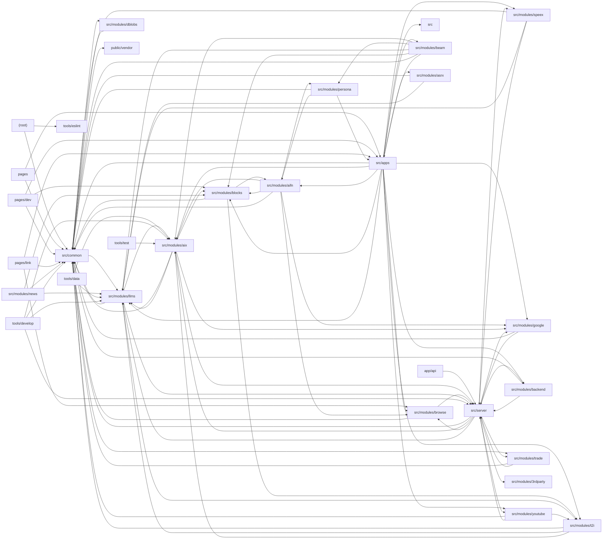

# Architecture

big-AGI is a Next.js (Pages router + App-router API routes) multi-model AI chat application. The client is organized into `src/apps` (feature shells: Chat, Call, Draw, Beam harness, Personas, News, Settings, Tokens), `src/common` (shared stores, layout/Optima shell, attachment pipeline, tokens, utils, chat data model), and `src/modules/*` (vertical capability modules: `aix` for the AI eXchange dispatch/parse/reassembly layer, `llms` for vendor catalogs and setup, `aifn` for focused AI utility functions, `beam` for scatter/gather multi-model synthesis, `blocks` for rich rendering, `speex`/`asrx`/`t2i` for voice and image engines, `browse`/`google`/`youtube`/`trade` for external integrations). Server-side code lives in `src/server` (tRPC edge and cloud routers, env validation, Prisma, PostHog, upstream fetch/retry) and is mounted by app/api/{edge,cloud}/[trpc]/route.ts. Pages are thin wrappers using `withNextJSPerPageLayout` around app components. State is Zustand-based (persistent and per-chat vanilla stores), data fetching uses tRPC + TanStack Query, UI uses MUI Joy with Emotion. `public/dev` holds zero-dependency vanilla-JS diagnostic/repair pages that work even when the app fails to boot. `tools/*` contains developer harnesses (AIX protocol lab, Anthropic/Gemini probes, catalog syncs), custom ESLint rules, code generators, and scale tests.

## Modules

| module | summary | AI |
| --- | --- | --- |
| `.claude/scripts` | Node CLI script parsing Ollama library HTML into model metadata records. | — |
| `(root)` | Next.js build/Webpack config, build-hash generation, module mocks, and flat ESLint configuration. | — |
| `app/api` | Next.js route handlers mounting the tRPC cloud (Node) and edge routers. | — |
| `pages` | Pages-router entry points, root App/Document providers, and per-route layout wrappers for the app suites. | — |
| `pages/dev` | Developer debug export page and LLM capabilities inspection route. | — |
| `pages/link` | OpenRouter OAuth callback, shared chat link viewer, and PWA share-target routes. | — |
| `public` | Static assets including the single-tab 'session moved' notice page. | — |
| `public/dev` | Zero-dependency vanilla-JS browser diagnostics and storage repair tools served statically. | [AI] |
| `public/vendor` | Static vendor bundles (SheetJS mini) served to the client. | — |
| `public/workers` | Pre-built PDF.js web worker bundle. | — |
| `src` | AI persona system-purpose presets, prompt templates, and voice/call starters (data.ts). | [AI] |
| `src/apps` | Feature application shells: Chat (composer, messages, render tree, editors), Call, Draw, Beam harness, Personas, News, Settings, Tokens, Diff, LinkChat, LLM capabilities. | [AI] |
| `src/common` | Shared infrastructure: attachment pipeline, chat/LLM/metrics stores, Optima layout, components, tokens, logging, routing, providers, and utilities. | [AI] |
| `src/modules/3rdparty` | In-tree t3-env fork for typed environment variable validation. | — |
| `src/modules/aifn` | Focused AI utility functions: auto-title, follow-ups, code fixup, diagrams, flatten, captions, imagine, ReAct agent, LLM chains. | [AI] |
| `src/modules/aix` | AI eXchange: client request building/reassembly/debugger plus server dispatch, vendor adapters, stream demuxers, parsers, retries, and wire types. | [AI] |
| `src/modules/asrx` | Multi-vendor speech-to-text engines with LLM-service auto-linking and client-side batch transcription. | [AI] |
| `src/modules/backend` | Backend capability detection router and client-side capabilities store, plus OpenRouter key exchange. | — |
| `src/modules/beam` | Beam scatter/gather multi-model workflow UI, vanilla store, fusion factories, and upstream reattach. | [AI] |
| `src/modules/blocks` | Rich block rendering: markdown/LaTeX, code with Prism, Mermaid/PlantUML/Chart.js with AI fixup, images, HTML sandboxes, diffs. | [AI] |
| `src/modules/browse` | Puppeteer-over-WSS page fetching, markdown conversion, and browsing settings. | — |
| `src/modules/dblobs` | Dexie/IndexedDB storage for large binary assets with thumbnails, scoping, and GC. | [AI] |
| `src/modules/google` | Google Programmable Search integration and Vertex AI grounding-link resolution. | — |
| `src/modules/llms` | LLM vendor registry, model catalogs/pricing, access schemas, model-listing routers, setup UIs, and client refresh logic. | [AI] |
| `src/modules/news` | What's New changelog/announcements feed, docs reader, and seen-state store. | [AI] |
| `src/modules/persona` | Prompt Mixer template variable substitution for persona/system prompts. | [AI] |
| `src/modules/speex` | Multi-vendor text-to-speech engines, text chunking, RPC/CSF synthesis, and WebSpeech integration. | [AI] |
| `src/modules/t2i` | Text-to-image engines (OpenAI/Azure/LocalAI/OpenRouter/Gemini) with auto-linking and fragment generation. | [AI] |
| `src/modules/trade` | Chat import/export, flash backup/restore, Claude Code export, and Prisma-backed shared chat links. | [AI] |
| `src/modules/youtube` | YouTube transcript/metadata scraping router, hooks, and URL input UI. | — |
| `src/server` | tRPC server context/routers (edge and cloud), env validation, Prisma, PostHog, upstream fetchers and retry profiles. | [AI] |
| `tools/data` | CLI syncing LLM vendor model catalogs into SQLite with change history. | [AI] |
| `tools/develop` | Developer harnesses: AIX protocol lab, Anthropic/Gemini probes, Claude Code tape analysis, code generators, parameter sweeps, minify checks. | [AI] |
| `tools/eslint` | Custom ESLint rules for memo props, outcome type casts, SWC miscompiles, and sx computed values. | — |
| `tools/test` | Mock-server scale test for the OpenAI container keep-alive companion. | [AI] |

## Module dependencies

_`[AI]` marks modules with AI/LLM touchpoints (prompt files, model API calls, agent logic)._
