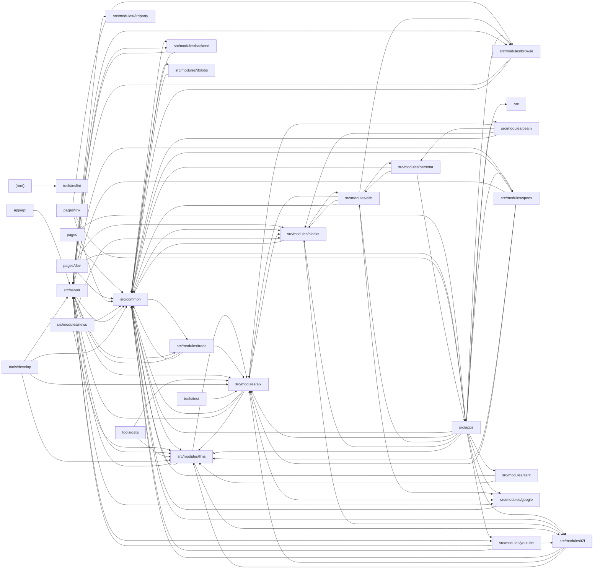

# Architecture

Big-AGI is a Next.js (Pages router + App Router API routes) TypeScript application for multi-model AI chat. The UI layer (pages/, src/apps) is built on MUI Joy and Zustand stores, with shared primitives, stores, tokenizers, attachment pipelines and layout shells in src/common. Feature modules in src/modules provide AI capabilities: AIX is the unified client/server execution and streaming layer that adapts a single chat-generation request to Anthropic, Bedrock, Gemini, OpenAI, xAI and compatible vendors; llms manages vendor catalogs, credentials and model metadata; aifn, beam, persona, t2i, speex, asrx, browse and google layer auxiliary AI functions (auto-title, ReAct, diagrams, multi-model Beam, TTS/ASR, image generation, web browsing) on top. src/server hosts tRPC routers split between Edge (AI inference, vendor routers, speech, search) and Node/Cloud runtimes (browse, trade with Prisma), exposed via app/api route handlers. Static diagnostic tools (public/dev), vendored workers/libraries, custom ESLint rules (tools/eslint) and extensive developer harnesses (tools/develop, tools/data, tools/test) round out the repository.

## Modules

| module | summary | AI |
| --- | --- | --- |
| `.claude/scripts` | Developer CLI script parsing Ollama library HTML into pipe-delimited model records. | — |
| `(root)` | Next.js, Webpack (WASM, client mocks) and ESLint flat configuration for the whole project. | — |
| `app/api` | App Router tRPC route handlers for Node ('cloud') and Edge runtimes with PostHog exception tracking. | — |
| `pages` | Pages-router entry points: _app/_document providers and per-app routes wrapped in the Optima layout. | — |
| `pages/dev` | Internal debug dashboard and LLM capabilities inspection pages. | — |
| `pages/link` | External entry routes: OpenRouter OAuth callback, shared chat link viewer, Web Share Target ingestion. | — |
| `public` | Static assets including the 'session moved to another tab' fallback page. | — |
| `public/dev` | Zero-dependency vanilla JS storage doctor, healer, log viewer and inspector that work when the app cannot boot. | [AI] |
| `public/vendor` | Vendored SheetJS mini bundle for client-side spreadsheet parsing. | — |
| `public/workers` | Pre-built PDF.js web worker for off-thread PDF parsing. | — |
| `src` | Catalog of predefined AI system personas (SystemPurposes) with prompt templates and voices. | [AI] |
| `src/apps` | End-user applications: AppChat workspace (composer, messages, render tree, panes, editors), Beam, Call, Draw, Diff, Personas, Tokens, News, settings modal. | [AI] |
| `src/common` | Shared foundation: attachment drafts, chat/LLM/metrics stores, tokenizers, UI primitives, Optima layout, logger, events, tRPC client, utilities and hooks. | [AI] |
| `src/modules/3rdparty` | Vendored T3-Env fork providing type-safe environment variable validation (Standard Schema V1). | — |
| `src/modules/aifn` | Auxiliary AI functions: auto-title, flatten, diagrams, code fixup, image captioning, prompt imagining, LLM chains, ReAct agent. | [AI] |
| `src/modules/aix` | AI eXchange execution layer: request normalization, vendor adapters/parsers, particle streaming, retries, continuation, CSF direct mode and debugger. | [AI] |
| `src/modules/asrx` | Speech recognition engine registry and batch transcription clients for Deepgram, Gemini and OpenAI. | [AI] |
| `src/modules/backend` | tRPC router exposing server capability flags and OpenRouter key exchange, plus client capabilities store. | — |
| `src/modules/beam` | Multi-model scatter (rays) and gather (fusion) comparison/merge workspace with per-instance vanilla stores. | [AI] |
| `src/modules/blocks` | Rich content block parsing and rendering: Markdown/KaTeX, code with Prism, Mermaid/PlantUML/Chart.js, sandboxed HTML, images, diffs. | [AI] |
| `src/modules/browse` | Remote Puppeteer-based web page fetching, markdown conversion and screenshot capture via streaming tRPC. | — |
| `src/modules/dblobs` | Dexie/IndexedDB storage for large binary assets with thumbnails and scoped garbage collection. | [AI] |
| `src/modules/google` | Google Custom Search integration and Vertex AI grounding redirect resolution. | — |
| `src/modules/llms` | LLM vendor registry, credentials/access, model catalogs and pricing for 30+ providers, models configurator UI and tRPC vendor routers. | [AI] |
| `src/modules/news` | Remote changelog/news feed, seen-state tracking, What's New and docs reader modals. | [AI] |
| `src/modules/persona` | Prompt variable registry and prompt mixer injecting dates, rendering capabilities and model directives. | [AI] |
| `src/modules/speex` | Multi-engine text-to-speech (ElevenLabs, Gemini, Inworld, OpenAI, LocalAI, WebSpeech) with chunking and streaming playback. | [AI] |
| `src/modules/t2i` | Text-to-image engine registry and generation across OpenAI, Azure, LocalAI, OpenRouter and Gemini. | [AI] |
| `src/modules/trade` | Import/export, flash backup/restore, Claude Code export and unlisted cloud chat link sharing (Prisma-backed). | [AI] |
| `src/modules/youtube` | YouTube metadata and transcript extraction via tRPC for persona creation and attachments. | — |
| `src/server` | Server infrastructure: validated env, tRPC init/routers (edge and cloud), upstream fetchers with retry profiles, Prisma, PostHog. | [AI] |
| `tools/data` | CLI syncing vendor model listings and pricing into a local SQLite registry. | [AI] |
| `tools/develop` | Developer harnesses: AIX protocol lab, Anthropic/Gemini probes, parameter sweeps, model fingerprinting, codegen scripts, SWC minify checks. | [AI] |
| `tools/eslint` | Custom ESLint rules for memo prop stability, outcome type casts, SWC miscompile patterns and sx computed values. | — |
| `tools/test` | Mock-server scale test for the OpenAI sandbox container keep-alive companion. | [AI] |

## Module dependencies

_`[AI]` marks modules with AI/LLM touchpoints (prompt files, model API calls, agent logic)._
