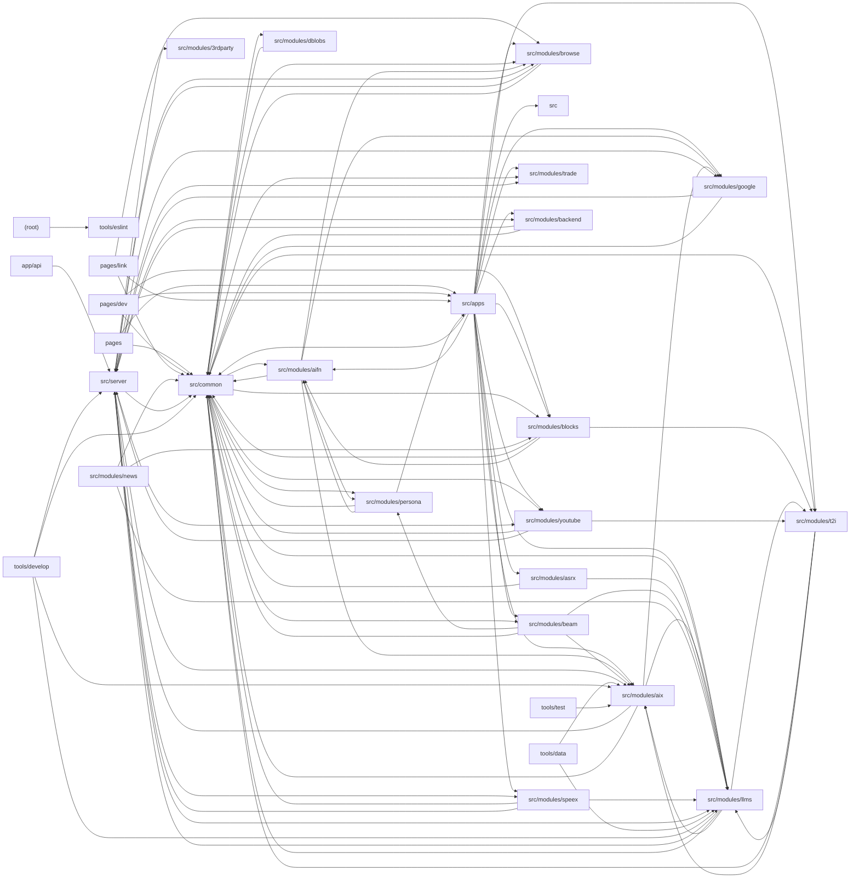

# Architecture

big-AGI is a Next.js (Pages router) TypeScript web application for multi-model LLM chat and related AI workflows (Beam multi-model comparison, voice Call, Draw text-to-image, Personas, Diff, Tokens). The client is built on React + MUI Joy + Zustand stores, with tRPC used for both an Edge runtime API (/api/edge: AIX inference streaming, LLM provider discovery, search, speech, YouTube) and a Node runtime API (/api/cloud: Puppeteer browsing, trade/share-link persistence via Prisma). The architectural core is AIX (src/modules/aix): the client assembles a universal ChatGenerate request from DMessage fragments, the server/edge dispatch layer adapts it to vendor wire formats (Anthropic, Bedrock, Gemini, OpenAI Chat/Responses, xAI, Ollama), demuxes streams (SSE / AWS EventStream / JSON-NL) through vendor parsers into normalized 'particles', and the client ContentReassembler rebuilds them into message fragments; a client-side-fetch (CSF) path allows direct browser-to-vendor calls. src/common hosts shared domain models (DConversation/DMessage/fragments), LLM/service stores and domain-model heuristics, token estimation, attachment-draft pipelines, layout (Optima shell), and cross-cutting utilities; src/modules provides feature modules (llms vendor catalog and setup, beam, blocks rendering, aifn utility AI functions, persona prompt mixing, speex TTS, asrx STT, t2i, browse, google, dblobs, trade, news). Thin pages/ route files mount apps via withNextJSPerPageLayout. tools/ contains developer CLIs (AIX protocol lab, vendor probes, codegens), custom ESLint rules, and mock scale tests; public/dev ships zero-dependency static diagnostic/repair tools.

## Modules

| module | summary | AI |
| --- | --- | --- |
| `.claude/scripts` | Node CLI that regex-parses the Ollama library HTML into pipe-delimited model metadata (capabilities, sizes, pulls). | — |
| `(root)` | Next.js, Webpack, TypeScript and ESLint flat configuration including custom repository lint rules. | — |
| `app/api` | Next.js Route Handlers dispatching tRPC fetch requests to the Node (/api/cloud) and Edge (/api/edge) routers. | — |
| `pages` | Pages-router entrypoints (_app, _document, per-app routes) mounting big-AGI apps inside the Optima layout with tRPC/Emotion providers. | — |
| `pages/dev` | Developer diagnostics pages for client/store/server state dumps and the LLM capabilities inspector. | — |
| `pages/link` | External-integration link pages: OpenRouter OAuth callback, shared chat link viewer, and PWA Web Share Target. | — |
| `public` | Static assets including the closed-session fallback HTML page. | — |
| `public/dev` | Zero-dependency static HTML/JS tools for inspecting and repairing browser storage, logs, and boot health. | [AI] |
| `public/vendor` | Vendored minified SheetJS (xlsx) bundle for client-side spreadsheet parsing. | — |
| `public/workers` | Precompiled PDF.js web worker served statically for off-thread PDF parsing. | — |
| `src` | Built-in persona (SystemPurpose) definitions with system prompts, template placeholders, examples and voice settings. | [AI] |
| `src/apps` | Feature applications: Chat (composer, message rendering, panes, editors), Beam, Call, Draw, Personas, Diff, News, Tokens, LLM capabilities, Settings modal. | [AI] |
| `src/common` | Shared client infrastructure: chat/LLM/folder/metrics Zustand stores, attachment pipelines, UI components, Optima layout, tokens, tRPC client and utilities. | [AI] |
| `src/modules/3rdparty` | Vendored t3-env style environment validation with Standard Schema support and client/server prefix isolation. | — |
| `src/modules/aifn` | Focused utility AI functions: auto-titles, attachment prompts, code fixup, diagrams, flattening, image captioning, prompt expansion, LLM chains, ReAct. | [AI] |
| `src/modules/aix` | AI eXchange engine: client request assembly and reassembly, server/edge dispatch adapters, vendor parsers, stream demuxers and wire schemas. | [AI] |
| `src/modules/asrx` | Speech-to-text engines and client-side batch transcription across Deepgram, Gemini and OpenAI. | [AI] |
| `src/modules/backend` | tRPC router exposing server capabilities (preconfigured providers, DB, browse) plus OpenRouter key exchange and a capabilities store. | — |
| `src/modules/beam` | Beam multi-model scatter/gather workspace: parallel rays, fusion instructions, state slices and stream reattachment. | [AI] |
| `src/modules/blocks` | Chat content block rendering pipeline: markdown (full and lite streaming), code with Prism, HTML sandbox, diagrams, charts, images, diffs. | [AI] |
| `src/modules/browse` | Puppeteer-over-WebSocket web page fetching and HTML-to-markdown conversion for attachments and agent tools. | — |
| `src/modules/dblobs` | Dexie/IndexedDB storage for large binary assets (images, audio) with scoped GC, thumbnails and live-query hooks. | [AI] |
| `src/modules/google` | Google Custom Search configuration/querying and Vertex AI grounding redirect link resolution. | — |
| `src/modules/llms` | LLM vendor registry, service setup UIs, model catalogs/pricing/capabilities for 25+ providers, server access/routers and model refresh client. | [AI] |
| `src/modules/news` | Remote changelog/announcements/docs reader with seen-watermark store and UI indicators. | [AI] |
| `src/modules/persona` | Prompt variable registry and prompt mixer (pmix) resolving template tokens against LLM and device context. | [AI] |
| `src/modules/speex` | Multi-vendor text-to-speech (ElevenLabs, OpenAI, Gemini, Inworld, LocalAI, WebSpeech) with chunking and isomorphic RPC/CSF execution. | [AI] |
| `src/modules/t2i` | Text-to-image engine store, vendor registry and client generation across OpenAI/Azure/LocalAI, OpenRouter and Gemini. | [AI] |
| `src/modules/trade` | Export/import/backup of chats, folders and services, Claude Code session export, and Prisma-backed unlisted share links. | [AI] |
| `src/modules/youtube` | YouTube metadata and transcript fetching via tRPC with URL input UI and ID extraction utilities. | — |
| `src/server` | Backend foundation: validated env, PostHog server client, Prisma singleton, tRPC server/routers (Edge and Cloud), fetchers with retry profiles and wire utilities. | [AI] |
| `tools/data` | CLI syncing LLM vendor model catalogs into a local SQLite registry with diffs. | [AI] |
| `tools/develop` | Developer CLIs: AIX protocol lab, vendor probes, parameter sweeps, model fingerprinting, Claude Code tape analysis, codegens, SWC minify checks. | [AI] |
| `tools/eslint` | Custom ESLint rules for memo-safe props, sx computed values, SWC miscompile patterns and banned outcome-type casts. | — |
| `tools/test` | Mock HTTP scale test for the OpenAI sandbox container keep-alive companion. | [AI] |

## Module dependencies

_`[AI]` marks modules with AI/LLM touchpoints (prompt files, model API calls, agent logic)._
