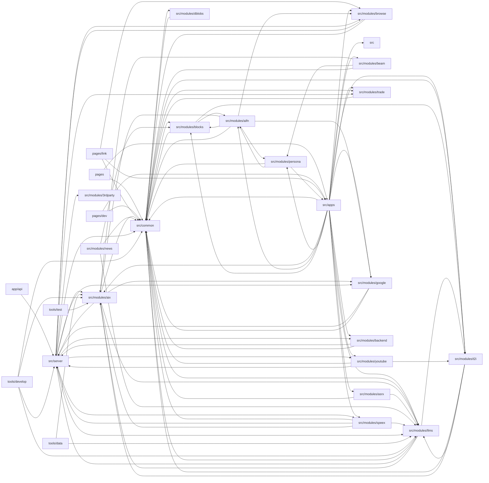

# Architecture

big-AGI is a Next.js (Pages router + App Router API routes) TypeScript application for multi-model LLM chat and adjacent AI tools (Beam multi-model scatter/gather, voice calls, text-to-image, personas, ReAct agents). The client is React + MUI Joy with Zustand stores and TanStack Query; the server is tRPC split across an Edge runtime router (/api/edge: AIX inference, vendor model listing, TTS, search) and a Node runtime router (/api/cloud: Puppeteer browsing, Prisma-backed link sharing). The core of the system is AIX (src/modules/aix): the client marshals DMessage fragments into wire requests, the server dispatches to vendor adapters (Anthropic, Bedrock, Gemini, OpenAI dialects, xAI), demuxes SSE/JSON-NL streams, and parsers emit normalized 'particles' that the client reassembles into fragments. src/modules/llms owns vendor adapters, model catalogs/pricing, and the models configuration UI; src/common provides shared stores (chats, llms, folders, metrics), attachment pipelines, layout shell (Optima), tokens, and utilities. Satellite modules cover TTS (speex), STT (asrx), T2I, aifn (auto-title, code fixup, diagrams, flatten), blocks rendering (markdown/code/diagrams), browse, google search, dblobs (IndexedDB assets), trade (import/export/share), news, and persona prompt mixing. tools/ holds CLI harnesses, protocol labs, codegen, and custom ESLint rules; public/dev holds zero-dependency HTML diagnostic tools.

## Modules

| module | summary | AI |
| --- | --- | --- |
| `.claude/scripts` | Node CLI parsing Ollama library HTML into pipe-delimited model metadata. | — |
| `(root)` | Next.js, Webpack/WASM, and ESLint flat configuration for the application. | — |
| `app/api` | App Router GET/POST tRPC handlers for Node (/api/cloud) and Edge (/api/edge) runtimes. | — |
| `pages` | Pages-router entry points, _app provider stack, _document SEO/Emotion SSR, and per-app routes. | — |
| `pages/dev` | Developer debug dashboard and LLM capabilities inspection pages. | — |
| `pages/link` | OpenRouter OAuth callback, shared chat link viewer, and Web Share Target intake routes. | — |
| `public` | Static closed-session notice HTML page. | — |
| `public/dev` | Dependency-free HTML/JS storage, logs, doctor, and heal diagnostic tools. | [AI] |
| `public/vendor` | Vendored minified SheetJS (xlsx) library for client spreadsheet parsing. | — |
| `public/workers` | Prebuilt PDF.js web worker script. | — |
| `src` | Persona definitions (system prompts, templates, examples, voices) in data.ts. | [AI] |
| `src/apps` | Top-level app views: Chat (composer, messages, panes, Beam wrapper), Call, Draw, Personas, Diff, Tokens, News, LLM capabilities, settings modal. | [AI] |
| `src/common` | Shared stores (chats, llms, folders, metrics), attachment pipeline, Optima layout, components, tokens, providers, and utilities. | [AI] |
| `src/modules/3rdparty` | Vendored t3-env for Standard Schema-based environment validation. | — |
| `src/modules/aifn` | AI auxiliary functions: auto-title, attachment prompts, code fixup, diagrams, flattening, image captioning, ReAct agent, LLM chains. | [AI] |
| `src/modules/aix` | AI execution layer: client request marshalling/reassembly, server dispatch adapters, stream demuxers, parsers, retries, debugger. | [AI] |
| `src/modules/asrx` | Speech-to-text engines and batch transcription across Deepgram, Gemini, OpenAI. | [AI] |
| `src/modules/backend` | Backend capabilities tRPC router and client cache store; OpenRouter key exchange. | — |
| `src/modules/beam` | Multi-model scatter (rays) and gather (fusion) workflow, stores, and reattach plumbing. | [AI] |
| `src/modules/blocks` | Message content block renderers: markdown, code (Prism), Chart.js/Mermaid/PlantUML/SVG, HTML iframes, diffs, images. | [AI] |
| `src/modules/browse` | Puppeteer-based page fetching, markdown conversion, screenshots, and settings. | — |
| `src/modules/dblobs` | Dexie/IndexedDB binary asset storage with scoped GC and React hooks. | [AI] |
| `src/modules/google` | Google Programmable Search and Vertex AI grounding link resolution. | — |
| `src/modules/llms` | LLM vendor adapters, server access/routers, model catalogs and pricing, models configuration UI, client refresh logic. | [AI] |
| `src/modules/news` | What's New changelog, announcements, and in-app docs reader. | [AI] |
| `src/modules/persona` | Prompt mixer (pmix) interpolating variables and LLM-capability conditionals into system prompts. | [AI] |
| `src/modules/speex` | Text-to-speech engines (ElevenLabs, Gemini, Inworld, LocalAI, OpenAI, WebSpeech), preprocessing, and playback. | [AI] |
| `src/modules/t2i` | Text-to-image engine configuration and generation for OpenAI, Azure, LocalAI, OpenRouter, Gemini. | [AI] |
| `src/modules/trade` | Import/export, Flash backups, Claude Code session export, and Prisma-backed shared chat links. | [AI] |
| `src/modules/youtube` | YouTube transcript/metadata extraction via tRPC for persona creation. | — |
| `src/server` | Env validation, tRPC init and edge/cloud routers, fetchers with retry profiles, Prisma, PostHog, wire debugging. | [AI] |
| `tools/data` | CLI syncing vendor model listings into a local SQLite registry. | [AI] |
| `tools/develop` | Developer harnesses: AIX protocol lab, Anthropic/Gemini probes, codegen (llms defs, icon sprites), Claude Code tape analysis, SWC minify checks. | [AI] |
| `tools/eslint` | Custom ESLint plugins: memo fresh-props, outcome no-cast, SWC miscompile patterns, sx computed values. | — |
| `tools/test` | Mock-based scale test for OpenAI sandbox container keepalive. | [AI] |

## Module dependencies

_`[AI]` marks modules with AI/LLM touchpoints (prompt files, model API calls, agent logic)._
