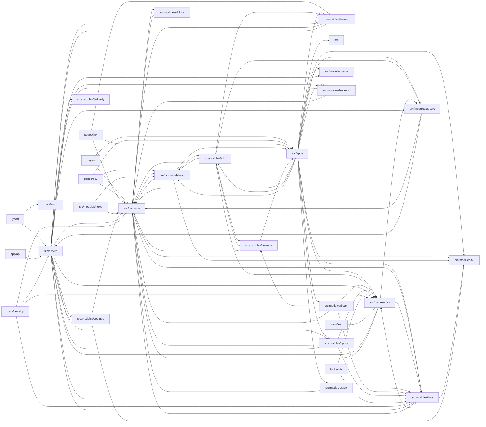

# Architecture

Big-AGI is a Next.js (Pages router) TypeScript application for multi-model AI chat, voice calls, text-to-image, personas and model comparison (Beam). Thin page wrappers in pages/ mount workspace apps from src/apps inside the Optima layout; shared UI, stores (Zustand), token math, attachment pipelines and utilities live in src/common. Feature modules under src/modules implement AI capabilities: the AIX layer (unified streaming chat-generation protocol with vendor adapters/parsers for Anthropic, Bedrock, Gemini, OpenAI, xAI, etc.), llms (vendor registry, model catalogs, server routers), aifn helper functions, beam scatter/gather, blocks rendering, speex TTS, asrx STT, t2i image generation, browse, google, trade and youtube. HTTP entry points in app/api route to tRPC routers aggregated in src/server for Edge (AI/LLM vendors) and Node/Cloud (browse, trade) runtimes, with env validation via an internal t3-env port. Static dev diagnostics and vendored workers sit in public/, and tools/ holds CLI harnesses (protocol lab, catalog sync, registry sync), custom ESLint rules and scale tests.

## Modules

| module | summary | AI |
| --- | --- | --- |
| `.claude/scripts` | Node CLI that parses Ollama library HTML into pipe-delimited model listings. | — |
| `(root)` | Next.js, Webpack (tiktoken WASM, server-module mocking) and ESLint flat configuration. | — |
| `app/api` | Next.js route handlers forwarding /api/edge and /api/cloud to tRPC routers on Edge and Node runtimes. | — |
| `pages` | Pages-router entry points, _app/_document shell, and thin Optima-layout wrappers around workspace apps. | — |
| `pages/dev` | Internal debug and LLM-capability inspection pages. | — |
| `pages/link` | OpenRouter OAuth callback, shared chat link viewer and PWA share-target routes. | — |
| `public` | Static assets and fallback HTML such as the closed-session page. | — |
| `public/dev` | Dependency-free browser diagnostic tools for storage, logs, health checks and healing. | [AI] |
| `public/vendor` | Vendored SheetJS bundle for spreadsheet parsing in the browser. | — |
| `public/workers` | Minified PDF.js web worker bundle. | — |
| `src` | System persona definitions, prompt templates and default purpose data (data.ts). | [AI] |
| `src/apps` | Workspace applications: Chat (composer, panes, message render tree), Call, Draw, Beam, Personas, LLM capabilities, settings and news. | [AI] |
| `src/common` | Shared UI components, layout (Optima), Zustand stores for chats/LLMs/metrics, attachment pipeline, tokens, tRPC client and utilities. | [AI] |
| `src/modules/3rdparty` | Internal t3-env port validating server/client environment variables via Standard Schema. | — |
| `src/modules/aifn` | Helper AI functions: auto-title, diagrams, code fixup, flatten, image caption, imagine prompts, ReAct agent, LLM chains. | [AI] |
| `src/modules/aix` | Unified AI eXchange layer: client request building/reassembly, edge tRPC router, vendor adapters, stream demuxers and particle parsers. | [AI] |
| `src/modules/asrx` | Speech-to-text engines (Deepgram, Gemini, OpenAI) with client-side dispatch and engine store. | [AI] |
| `src/modules/backend` | Backend capability detection router and client store, plus OpenRouter key exchange. | — |
| `src/modules/beam` | Multi-model scatter/gather comparison and fusion feature with vanilla Zustand slices. | [AI] |
| `src/modules/blocks` | Rich content rendering: markdown, code highlighting, Mermaid/PlantUML/Chart.js, diffs, images and LiveFile patching. | [AI] |
| `src/modules/browse` | Remote Puppeteer page fetching converted to HTML/text/Markdown for attachments and agents. | — |
| `src/modules/dblobs` | Dexie/IndexedDB storage and hooks for large image/audio blobs. | [AI] |
| `src/modules/google` | Google Programmable Search and Vertex AI grounding-link resolution. | — |
| `src/modules/llms` | LLM vendor registry, model catalogs, access/auth, server listing routers and configuration modals. | [AI] |
| `src/modules/news` | In-app changelog, announcements and docs reader with seen-state tracking. | [AI] |
| `src/modules/persona` | Prompt mixing engine (pmix) with variable registry for system prompt templates. | [AI] |
| `src/modules/speex` | Text-to-speech across ElevenLabs, Gemini, Inworld, OpenAI, LocalAI and WebSpeech with chunked playback. | [AI] |
| `src/modules/t2i` | Text-to-image engines (OpenAI/Azure/LocalAI, Gemini, OpenRouter) and content-fragment generation. | [AI] |
| `src/modules/trade` | Import/export, backups, Claude Code transcripts and shared chat links via Prisma storage. | [AI] |
| `src/modules/youtube` | YouTube URL parsing and transcript scraping via tRPC. | — |
| `src/server` | Env validation, tRPC initialization, Edge/Cloud router aggregation, upstream fetch/retry helpers, Prisma and PostHog. | [AI] |
| `tools/data` | CLI syncing LLM vendor model catalogs into a SQLite registry. | [AI] |
| `tools/develop` | Developer harnesses: AIX protocol lab, vendor probes, codegen for sprites/defs, minification checks. | [AI] |
| `tools/eslint` | Custom ESLint rules for memo props, sx values, SWC miscompiles and outcome-type casts. | — |
| `tools/test` | Scale test for the OpenAI container keep-alive adapter against a mock API. | [AI] |

## Module dependencies

_`[AI]` marks modules with AI/LLM touchpoints (prompt files, model API calls, agent logic)._
